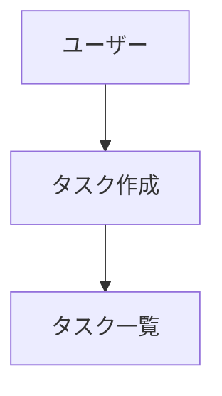

# CLAUDE.md (プロジェクトメモリ)

## 概要

このプロジェクトは Findy Campus Hackathon #2（2026/8/8開催、1日限りのハッカソン）で作るアプリです。
「動くものを素早く作り、デモできる状態にする」ことを最優先とし、ドキュメントは実装の助けになる最小限に留めます。
承認待ちで手が止まる時間を減らすため、確認ポイントは絞ります。

## プロジェクト構造

### ドキュメントの分類

#### 1. 永続的ドキュメント（`docs/`）— 2ファイルのみ

アプリ全体の「何を作るか」「どう作るか」。ハッカソンの時間感覚に合わせて最小構成にしています。

- **docs/product.md** - 何を作るか
  - プロダクトビジョン（一言で）
  - ターゲットユーザーと課題
  - MVPで実装する機能（must）／時間が余ったら（nice to have）
  - デモのゴール（何をもって完成とするか）

- **docs/architecture.md** - どう作るか
  - 技術スタック（実際に使っているものだけ書く：Hono / Vite / React 19 / Cloudflare Workers / Agents SDK。スタイリングは現状プレーンCSS。新しいライブラリを追加するときは先にここへ追記してから使う）
  - ディレクトリ構成（実態と乖離したら都度更新）
  - 命名・コーディング規約（最低限）
  - Git規約（コミット単位など最低限）
  - 図表（システム構成図・データモデルなど）もここに集約する

機能設計・リポジトリ構造・開発ガイドライン・用語集を個別ファイルに分けると、1日のハッカソンでは書く時間の方が長くなりがちなので統合しています。本当に必要になったらその都度 `docs/` に節を足してください。

#### 2. 作業単位のドキュメント（`.steering/[YYYYMMDD]-[開発タイトル]/task.md`）— 1ファイルのみ

requirements / design / tasklist を1ファイルに統合。中身は：

- やること（1〜2行）
- タスクリスト（チェックボックス）
- 完了条件（デモで動く状態、など）

小さい変更（バグ修正・UI微調整など）は `.steering` ファイルを作らず直接実装してOKです。ある程度まとまった機能を作るときだけ作成してください。

### ステアリングディレクトリの命名規則

```
.steering/[YYYYMMDD]-[開発タイトル]/
```

**例：**
- `.steering/20260808-initial-implementation/`
- `.steering/20260808-add-chat-ui/`

## 開発プロセス

### 初回セットアップ時の手順

1. `docs/product.md` と `docs/architecture.md` をまとめて一度に作成する
2. 内容をざっと確認してもらったら次へ進む（1ファイルごとの個別承認はしない）
3. `.steering/[YYYYMMDD]-initial-implementation/task.md` を作成
4. 実装開始

### 機能追加・修正時の手順

- **小さい変更**：`.steering` なしで直接実装
- **まとまった機能追加**：`.steering/[YYYYMMDD]-[開発タイトル]/task.md` を1つ作ってから着手
- **`docs/` への影響がある場合のみ**（技術スタック変更、MVPスコープ変更など）`docs/` を更新。基本は都度更新しない

### 確認ポイント（最小限に絞る）

以下のタイミングだけ確認を挟みます。それ以外は自律的に進めてよいです。

- 初回の `docs/product.md` + `docs/architecture.md` 作成直後（方向性のズレを防ぐ）
- Cloudflare へのデプロイ実行前（外部公開を伴うため）
- 破壊的な操作（依存関係の大幅な変更、データ構造の破壊的変更など）を行う前

### 品質チェック

- コード変更後は `npm run build`（型チェック含む）を通す
- 専用の lint は現状未設定。追加したらここに追記する

## 図表・ダイアグラムの記載ルール

- 配置場所は一本化：すべての図は `docs/architecture.md` に書く（迷わないため）
- **Mermaid記法**を使う（Markdownに埋め込め、編集もしやすい）
- 画像ファイル（PNG/SVG）はハッカソンの時間内では基本使わない。本当に複雑なワイヤフレームが必要な場合のみ `docs/images/` に配置



## 注意事項

- ハッカソンなので「動くこと」を最優先。ドキュメント整備より実装を優先していい場面ではそうする
- スタイリングは現状プレーンCSS。デザインシステムやCSSライブラリを追加する場合は、まず `docs/architecture.md` に追記してから使う（記述と実態の乖離を防ぐ）
- セキュリティの最低限（XSS対策、入力バリデーション）は省略しない
- `.steering/` のディレクトリ名は日付と開発タイトルで識別できるようにする
- 永続的ドキュメント（`docs/`）と作業単位のドキュメント（`.steering/`）を混同しない
