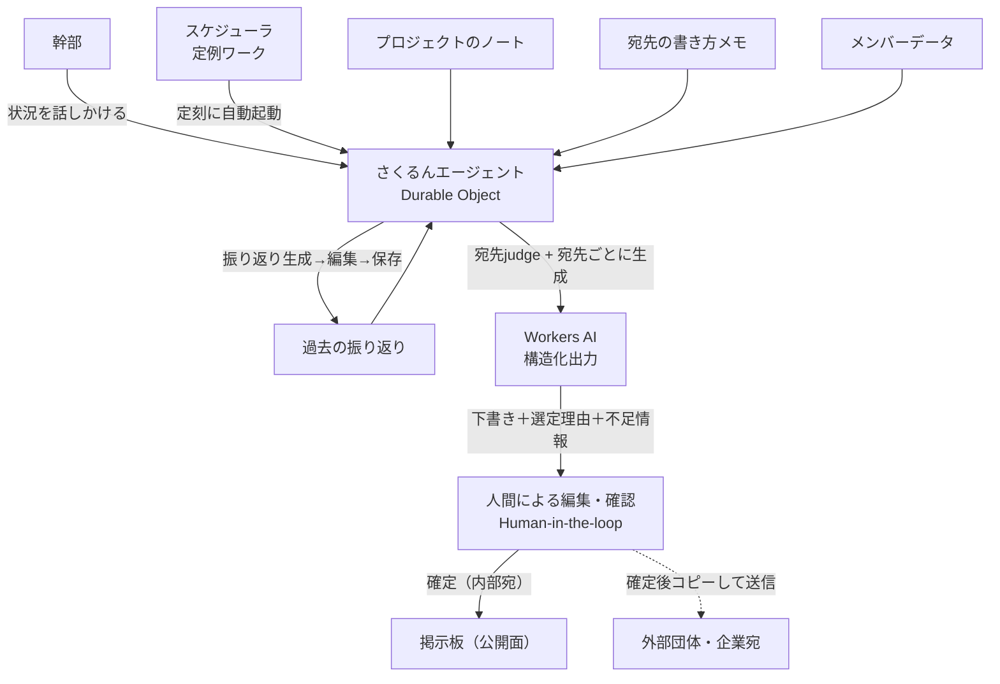

# さくるん — 技術仕様書

## 技術スタック
- フレームワーク: Hono（バックエンド） + Vite + React 19（フロントエンド）
- デプロイ先: Cloudflare Workers
- 状態管理・エージェント: Cloudflare Agents SDK（`agents` / `hono-agents`）、Durable Objects
- スタイリング: プレーンCSS（`src/style.css`）。新しいライブラリを追加する場合はここに追記してから使う
- AI: Workers AI binding（`env.AI`）。APIキー取得が不要で無料枠のみで完結するため採用。生成はJSON Schemaによる構造化出力（本文＋5W1H不足リスト、宛先判定）
- 外部連携: なし（Notion・Googleカレンダーは検討の末カット。実送信も人間が行う設計のため、外部へ出るのはWorkers AIへの生成リクエストのみ）

## データモデルの設計方針：決め打ちを避ける
- 宛先の分類・トーン指針は固定enumやコード埋め込みにせず、**自由記述の`label`と`styleNotes`（書き方メモ）**で表現し、ユーザーが画面上で編集して育てる
- コードに残る決め打ちは「内部/外部の区分（掲示板反映の判定）」と「メール/LINEの物理フォーマット指針」のみ
- 文脈（ドメイン知識）は**プロジェクト＋自由記述ノート**として蓄積。スキーマで縛らない。編集・削除可
- 保存済みの**振り返り（retrospective）は下書き生成時に全プロジェクト横断で注入**され、教訓が次の連絡に活きる。どの振り返りを参照したかは下書きに記録され、UIで「過去の教訓を反映」として見える

### 文脈の注入方式
データ量が少ない前提で、ノート・振り返りは生成時に**全件プロンプト注入**し、LLMに関連箇所を拾わせる。
蓄積が増えたら`generateDraft`内の注入部分をVectorize等の検索に差し替える（差し替えポイントはコードコメントに明記済み）。

### 宛先の自動判定（draftAuto）
状況文と宛先マスタ（ラベル・書き方メモ）をLLMに渡し、伝えるべき宛先と送信手段をJSONで判定させてから、宛先ごとに下書きを生成する。判定理由は下書きに保存され、UIで「さくるんがこの宛先を選んだ理由」として表示される。手動選択はフォールバックとして残す。

### 定例ワーク（routine）
Agents SDKのスケジュール機能を使用。
- 毎分（デモ用）: `scheduleEvery(60, 'runRoutine', routineId)`
- 毎日/毎週: cron式で`schedule(cron, 'runRoutine', routineId)`。Cloudflareのcron評価はUTCのため、JSTから変換して登録する
- `runRoutine`は下書きの自動生成まで行い、確定（送信）は人間が行う。クライアントから直接呼べないよう`@callable`は付けない

## ディレクトリ構成
```
src/
  index.tsx              - Honoサーバーエントリーポイント
  style.css               - グローバルスタイル
  agents/
    counter.ts            - サンプルDurable Objectエージェント
    sakurun.ts              - さくるんエージェント本体（宛先・プロジェクト・ノート・下書き・振り返り・定例）
    sakurun-types.ts         - さくるん関連の型・定数
  data/
    members.ts             - メンバーのサンプルデータ
    seed.ts                 - 宛先・プロジェクトの初期データ（振り返り済み例を含む）
  client/
    index.tsx              - クライアントエントリーポイント
    app.tsx                 - ルートコンポーネント
    counter.tsx             - サンプルコンポーネント
    sakurun.tsx              - さくるんのUI（タブ型）
docs/                    - 永続的ドキュメント
.steering/               - 作業単位のドキュメント
```

## UIの構造
タブ型。順序はユーザー（幹部）の行動起点で決めている：
1. **連絡をつくる** — アプリを開くトリガー「連絡を送らなきゃ」に直結。状況を話しかけるとさくるんが宛先まで判断（初期表示タブ）
2. **定例** — 「毎週同じ連絡を作ってる」と気づいた時に自動化へ持ち上げる隣の導線
3. **サークルの記憶** — 連絡作成中に情報不足に気づいたら整備しに行く、設定に近い場所
4. **掲示板（公開）** — 右端に置き、内と外の境界を位置で表す

UI文言は作り手側の内部概念（文脈・PDCA・モック・注入など）を出さず、ユーザーから見た効果で書く。

## 公開境界と既知の制約
- **公開面は掲示板のみ**という設計（下書き・記憶・定例は幹部の内側）だが、現状は認証・ロール分離が未実装のため、これは**UI上の区別に留まる**：
  - 全`@callable`メソッドはWebSocketに接続できる誰からでも呼べる
  - エージェントのstate全体（下書き・書き方メモ含む）が接続クライアント全員に配信される
- 本番化する場合は、部員向けの掲示板を別エージェント（またはHTTPエンドポイント）に分離し、幹部面に認証を入れるのが次の一手
- Cloudflare Workersの実行環境（`nodejs_compat`フラグ有効）
- ハッカソン当日（2026/8/8）中に動くデモを完成させることを優先し、過度な抽象化は避ける

## 命名・コーディング規約
- TypeScript / Reactの標準的な命名（コンポーネント：PascalCase、関数・変数：camelCase）に従う
- 現状lintは未設定。追加したらここに追記する

## Git規約
- 機能追加・修正ごとにコミットを分ける（大きな一括コミットは避ける）

## システム構成図

