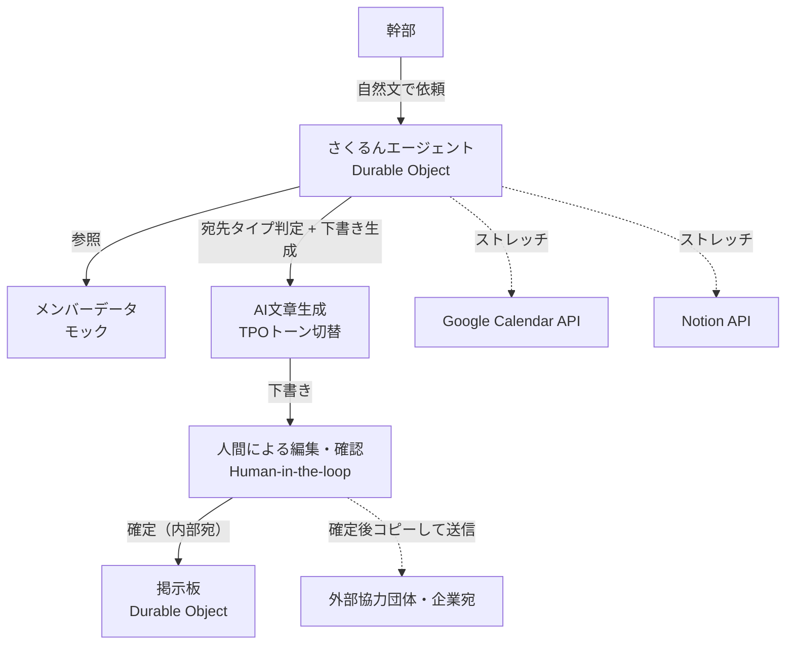

# さくるん — 技術仕様書

## 技術スタック
- フレームワーク: Hono（バックエンド） + Vite + React 19（フロントエンド）
- デプロイ先: Cloudflare Workers
- 状態管理・エージェント: Cloudflare Agents SDK（`agents` / `hono-agents`）、Durable Objects
- スタイリング: プレーンCSS（`src/style.css`）。新しいライブラリを追加する場合はここに追記してから使う
- AI: Workers AI binding（`env.AI`）。APIキー取得が不要で無料枠のみで完結するため採用
- 外部連携（ストレッチ）: Google Calendar API（OAuth、単一アカウント想定）、Notion API（Integration Token）

## ディレクトリ構成
```
src/
  index.tsx              - Honoサーバーエントリーポイント（/auth/google のOAuthルートもここ）
  env.d.ts                - Cloudflareの秘密情報（GOOGLE_*, NOTION_*）の型定義
  style.css                - グローバルスタイル
  agents/
    counter.ts            - サンプルDurable Objectエージェント
    sakurun.ts              - さくるんエージェント本体
    sakurun-types.ts         - さくるん関連の型・定数
  integrations/
    google-calendar.ts     - Google Calendar OAuth・イベント作成
    notion.ts               - Notionページ作成（引き継ぎ文書）
  data/
    members.ts             - メンバーのモックデータ
  client/
    index.tsx              - クライアントエントリーポイント
    app.tsx                 - ルートコンポーネント
    counter.tsx             - サンプルコンポーネント
    sakurun.tsx              - さくるんの動作確認用UI（簡易モック）
docs/                    - 永続的ドキュメント
.steering/               - 作業単位のドキュメント
```
実装が進んだら実態に合わせて更新する。

## 環境変数（ストレッチ機能用）
MVP（メンバー参照・AI下書き・掲示板）は追加設定なしで動く。ストレッチ機能を有効にするときだけ、`.dev.vars`（ローカル）または`wrangler secret put`（本番）で以下を設定する。値は`.dev.vars.example`を参照。

- `GOOGLE_CLIENT_ID` / `GOOGLE_CLIENT_SECRET` — Google CalendarのOAuth用
- `NOTION_TOKEN` / `NOTION_PARENT_PAGE_ID` — Notionへの引き継ぎ文書保存用

未設定の場合、該当ツールを呼ぶとエラーメッセージを返すだけで、他の機能には影響しない。

## 命名・コーディング規約
- TypeScript / Reactの標準的な命名（コンポーネント：PascalCase、関数・変数：camelCase）に従う
- 現状lintは未設定。追加したらここに追記する

## Git規約
- 機能追加・修正ごとにコミットを分ける（大きな一括コミットは避ける）

## システム構成図


宛先タイプ（幹部／メンバー／タスク依頼相手／外部協力団体／企業）はLLM呼び出し時のプロンプトに反映し、トーン・フォーマルさを切り替える。下書きは必ずReview（人間の確認・編集）を経てから確定する。

## 技術的制約
- Cloudflare Workersの実行環境（`nodejs_compat`フラグ有効）
- ハッカソン当日（2026/8/8）中に動くデモを完成させることを優先し、過度な抽象化は避ける
