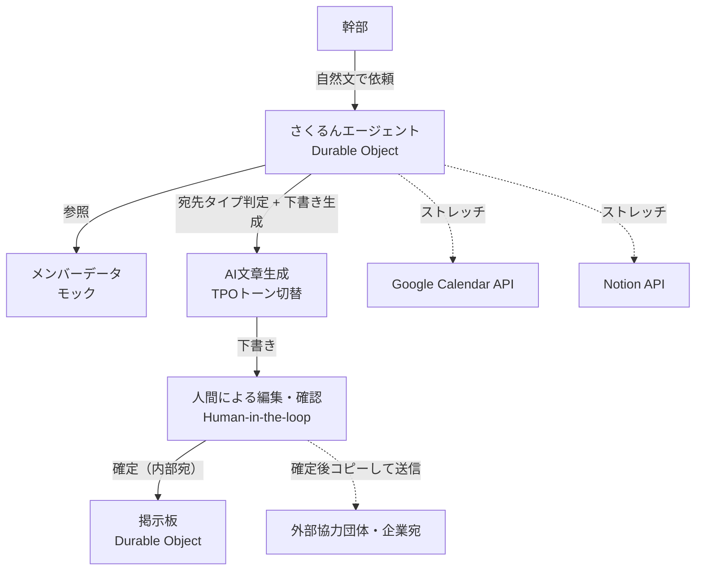

# さくるん — 技術仕様書

## 技術スタック
- フレームワーク: Hono（バックエンド） + Vite + React 19（フロントエンド）
- デプロイ先: Cloudflare Workers
- 状態管理・エージェント: Cloudflare Agents SDK（`agents` / `hono-agents`）、Durable Objects
- スタイリング: プレーンCSS（`src/style.css`）。新しいライブラリを追加する場合はここに追記してから使う
- AI: 未確定（Workers AI bindingかClaude API経由のいずれか。実装時に決定してここに追記する）
- 外部連携（ストレッチ）: Google Calendar API（OAuth、単一アカウント想定）、Notion API（Integration Token）

## ディレクトリ構成
```
src/
  index.tsx        - Honoサーバーエントリーポイント
  style.css         - グローバルスタイル
  agents/
    counter.ts      - サンプルDurable Objectエージェント（さくるんエージェントもここに追加していく）
  client/
    index.tsx        - クライアントエントリーポイント
    app.tsx           - ルートコンポーネント
    counter.tsx       - サンプルコンポーネント
docs/                - 永続的ドキュメント
.steering/           - 作業単位のドキュメント
```
実装が進んだら実態に合わせて更新する。

## 命名・コーディング規約
- TypeScript / Reactの標準的な命名（コンポーネント：PascalCase、関数・変数：camelCase）に従う
- 現状lintは未設定。追加したらここに追記する

## Git規約
- 機能追加・修正ごとにコミットを分ける（大きな一括コミットは避ける）

## システム構成図


宛先タイプ（幹部／メンバー／タスク依頼相手／外部協力団体／企業）はLLM呼び出し時のプロンプトに反映し、トーン・フォーマルさを切り替える。下書きは必ずReview（人間の確認・編集）を経てから確定する。

## 技術的制約
- Cloudflare Workersの実行環境（`nodejs_compat`フラグ有効）
- ハッカソン当日（2026/8/8）中に動くデモを完成させることを優先し、過度な抽象化は避ける
