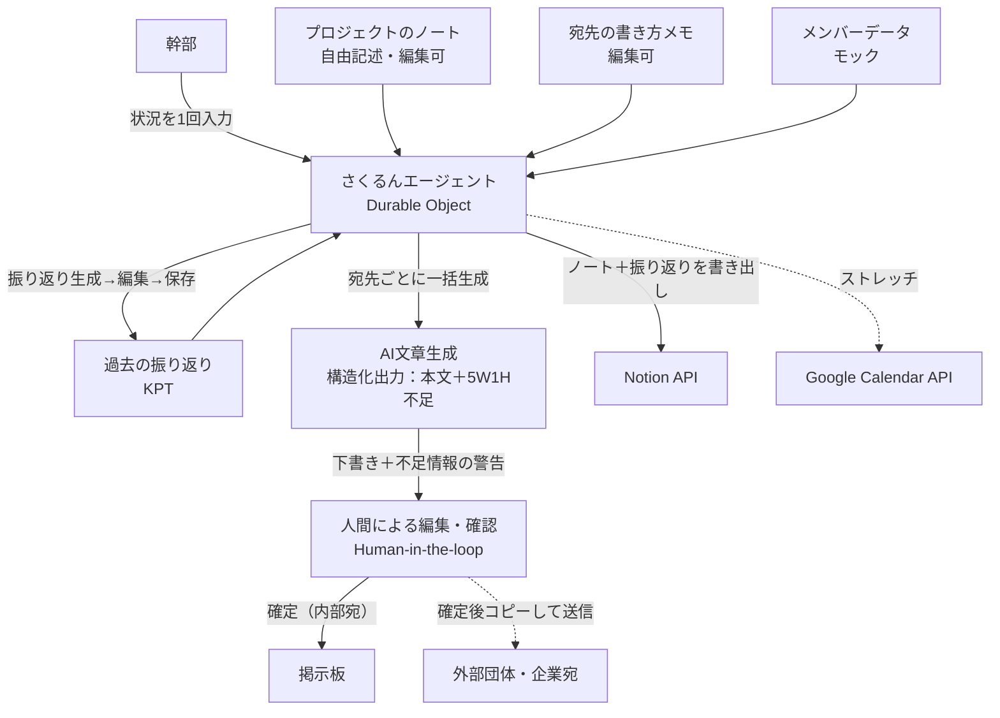

# さくるん — 技術仕様書

## 技術スタック
- フレームワーク: Hono（バックエンド） + Vite + React 19（フロントエンド）
- デプロイ先: Cloudflare Workers
- 状態管理・エージェント: Cloudflare Agents SDK（`agents` / `hono-agents`）、Durable Objects
- スタイリング: プレーンCSS（`src/style.css`）。新しいライブラリを追加する場合はここに追記してから使う
- AI: Workers AI binding（`env.AI`）。APIキー取得が不要で無料枠のみで完結するため採用。下書き生成はJSON Schemaによる構造化出力（本文＋5W1H不足リスト）
- 外部連携: Notion API（Integration Token、プロジェクトの書き出し）、Google Calendar API（OAuth、単一アカウント想定・ストレッチ）

## データモデルの設計方針：決め打ちを避ける
- 宛先の分類・トーン指針は固定enumやコード埋め込みにせず、**自由記述の`label`と`styleNotes`（書き方メモ）**で表現し、ユーザーが画面上で編集して育てる
- コードに残る決め打ちは「内部/外部の区分（掲示板反映の判定）」と「メール/LINEの物理フォーマット指針」のみ
- 文脈（ドメイン知識）は**プロジェクト＋自由記述ノート**として蓄積。スキーマで縛らない。編集・削除可
- 保存済みの**振り返り（retrospective）は次の下書き生成時に全プロジェクト横断で注入**され、教訓が次のPlanに活きる（PDCA）

### 文脈の注入方式
データ量が少ない前提で、ノート・振り返りは生成時に**全件プロンプト注入**し、LLMに関連箇所を拾わせる。
蓄積が増えたら`draftMessage`内の注入部分をVectorize等の検索に差し替える（差し替えポイントはコードコメントに明記済み）。

## ディレクトリ構成
```
src/
  index.tsx              - Honoサーバーエントリーポイント（/auth/google のOAuthルートもここ）
  env.d.ts                - Cloudflareの秘密情報（GOOGLE_*, NOTION_*）の型定義
  style.css                - グローバルスタイル
  agents/
    counter.ts            - サンプルDurable Objectエージェント
    sakurun.ts              - さくるんエージェント本体（宛先・プロジェクト・ノート・下書き・振り返り）
    sakurun-types.ts         - さくるん関連の型・定数
  integrations/
    google-calendar.ts     - Google Calendar OAuth・イベント作成
    notion.ts               - Notionページ作成（汎用。プロジェクト書き出しに使用）
  data/
    members.ts             - メンバーのモックデータ
    seed.ts                 - 宛先・プロジェクトの初期データ（振り返り済み例を含む）
  client/
    index.tsx              - クライアントエントリーポイント
    app.tsx                 - ルートコンポーネント
    counter.tsx             - サンプルコンポーネント
    sakurun.tsx              - さくるんのUI
docs/                    - 永続的ドキュメント
.steering/               - 作業単位のドキュメント
```
実装が進んだら実態に合わせて更新する。

## 環境変数（外部連携用）
コア機能（ノート蓄積・AI下書き・振り返り・掲示板）は追加設定なしで動く。外部連携を有効にするときだけ、`.dev.vars`（ローカル）または`wrangler secret put`（本番）で以下を設定する。値は`.dev.vars.example`を参照。

- `NOTION_TOKEN` / `NOTION_PARENT_PAGE_ID` — プロジェクト（ノート＋振り返り）のNotion書き出し用
- `GOOGLE_CLIENT_ID` / `GOOGLE_CLIENT_SECRET` — Google CalendarのOAuth用（ストレッチ）

未設定の場合、該当ツールを呼ぶとエラーメッセージを返すだけで、他の機能には影響しない。

## 命名・コーディング規約
- TypeScript / Reactの標準的な命名（コンポーネント：PascalCase、関数・変数：camelCase）に従う
- 現状lintは未設定。追加したらここに追記する

## Git規約
- 機能追加・修正ごとにコミットを分ける（大きな一括コミットは避ける）

## システム構成図


下書きは必ずReview（人間の確認・編集）を経てから確定する。振り返りも同様にAI生成→人間編集→保存のフロー。

## 技術的制約
- Cloudflare Workersの実行環境（`nodejs_compat`フラグ有効）
- ハッカソン当日（2026/8/8）中に動くデモを完成させることを優先し、過度な抽象化は避ける
